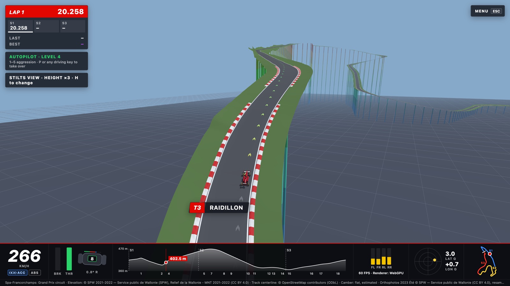
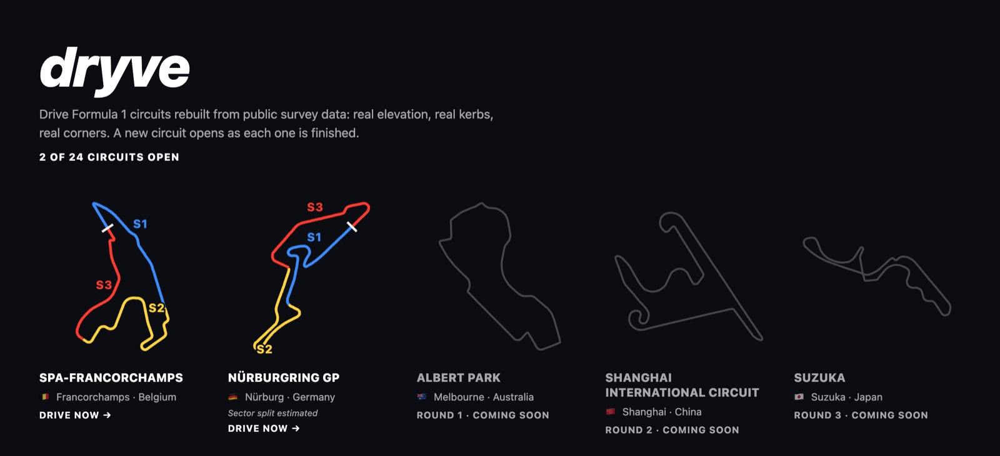

<h1 align="center">dryve</h1>

<p align="center">
  <b>Drive real Formula 1 circuits in your browser.</b><br>
  Rebuilt from public survey data: real elevation, real kerbs, real corners.
</p>

<p align="center">
  <a href="https://dryve.fast"><b>Drive now at dryve.fast →</b></a>
</p>



## What it is

dryve is a driving game that runs in a web page, with nothing to install. Each circuit is built from open
data: the track's line from OpenStreetMap, the ground from national laser-scan elevation surveys, and
aerial photos, trees and buildings around it. So when the road climbs out of Eau Rouge, it climbs as
much as the real one does.

Pick a circuit, then drive it yourself or let the autopilot take you round on the racing line.



## Circuits

**Open now:** Spa-Francorchamps and the Nürburgring GP.

The rest of the 2026 calendar is on the circuit list, and each one opens as it is finished.

## Driving

| | Keyboard |
|---|---|
| Throttle | <kbd>W</kbd> or <kbd>↑</kbd> |
| Brake, reverse when stopped | <kbd>S</kbd> or <kbd>↓</kbd> |
| Brake only | <kbd>Space</kbd> |
| Steer | <kbd>A</kbd> <kbd>D</kbd> or <kbd>←</kbd> <kbd>→</kbd> |
| Back to the grid | <kbd>R</kbd> |
| Autopilot on or off · aggression | <kbd>P</kbd> · <kbd>1</kbd>–<kbd>5</kbd> |
| Camera: chase, drone, nose | <kbd>C</kbd> |
| Elevation view · height ×1–3 | <kbd>V</kbd> · <kbd>H</kbd> |
| Racing line · aerial photo · trees · buildings | <kbd>G</kbd> · <kbd>O</kbd> · <kbd>T</kbd> · <kbd>B</kbd> |
| Sound | <kbd>M</kbd> |
| Menu and pause | <kbd>Esc</kbd> |

**On a phone,** turn it sideways. Your left thumb steers on the pad: drag left or right, further for
more steering. Your right thumb works the brake and gas. Holding the phone upright, you can still ride
along on the autopilot.

**Two driving modes:**
- **Accessible** has ABS and forgiving grip.
- **Simulation** has no ABS and a limited grip budget for each tyre.

The mode shows next to the ABS light under your speed. Lap and sector times are kept for each circuit
and mode, and your best laps are saved in your browser. Autopilot laps aren't saved as yours.

## Seeing the hills

Press <kbd>V</kbd> for the elevation view: the circuit stands on coloured stilts above a flat floor,
and <kbd>H</kbd> stretches the heights two or three times so every rise and drop is easy to see. The
strip in the instrument bar shows the whole lap's elevation profile and where you are on it.

## Run it locally

You need [Bun](https://bun.sh) and a browser with WebGPU. Without WebGPU, it falls back to WebGL 2.

```sh
bun install
bun run dev      # local dev server
bun run build    # type-check and production build into dist/
```

The circuits' baked data is in `public/data/`, so nothing needs downloading to drive.

## Built with

[three.js](https://threejs.org) (WebGPU renderer), [Rapier](https://rapier.rs) physics,
[Vite](https://vite.dev) and TypeScript.

## Data and credits

- **Track lines and building footprints:** © OpenStreetMap contributors, [ODbL](https://opendatacommons.org/licenses/odbl/).
- **Spa-Francorchamps:** elevation, surface heights and 2023 orthophotos © SPW, Service public de Wallonie, [CC BY 4.0](https://creativecommons.org/licenses/by/4.0/).
- **Nürburgring:** elevation, surface heights and orthophotos © GeoBasis-DE / LVermGeoRP, [dl-de/by-2-0](https://www.govdata.de/dl-de/by-2-0), data processed.
- **Circuit outlines on the circuit list:** [bacinger/f1-circuits](https://github.com/bacinger/f1-circuits) (MIT).
- **Spa's racing line:** computed with the minimum-curvature method from TUM's [trajectory_planning_helpers](https://github.com/TUMFTM/trajectory_planning_helpers) (LGPL-3.0).

dryve is an independent fan project. It is not affiliated with Formula 1, the FIA or any circuit.
